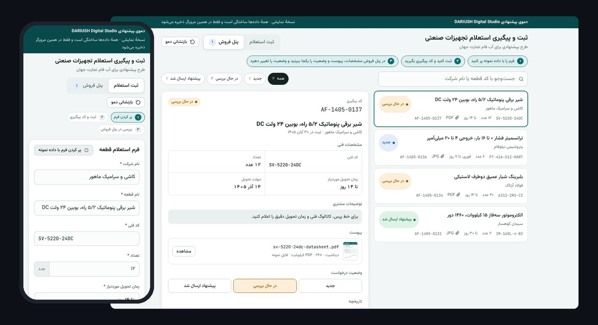

<div align="center">
  <h1>Industrial Equipment Inquiry Demo</h1>
  <p><b>A Persian, right-to-left web demo for registering and tracking industrial equipment inquiries, with a sales panel.</b></p>
  <p>Proposal demo by <b>DARIUSH Digital Studio</b> for <b>Ab Fam Tejarat Jahan</b> · all data is fictional</p>
  <p>
    <a href="https://dariush-tech.github.io/abfam-inquiry-demo/"><b>Live demo</b></a> ·
    <a href="#demo-flow">Demo flow</a> ·
    <a href="#run-locally">Run locally</a>
  </p>
  <p>
    
    
    
    
    
  </p>
  
</div>

<div dir="rtl">

### خلاصه

دموی پیشنهادی DARIUSH Digital Studio برای آب فام تجارت جهان: مشتری استعلام قطعهٔ صنعتی را با کد فنی، تعداد، زمان تحویل و پیوست ثبت می‌کند و کد پیگیری می‌گیرد؛ کارشناس فروش همان درخواست را با مشخصات فنی، پیوست و وضعیت در یک صفحه می‌بیند و وضعیت را تغییر می‌دهد. همهٔ داده‌ها ساختگی است و فقط در مرورگر بیننده ذخیره می‌شود.

</div>

## Demo flow

The whole path takes under a minute:

1. **Fill the form.** "پر کردن فرم با داده نمونه" fills company, part name, technical code, quantity, required delivery time, notes and a sample attachment.
2. **Submit.** A demo tracking code such as `AF-1405-0137` appears, and the inquiry is added to the sales panel right away with the status *New*.
3. **Review in the sales panel.** Technical specs, the attachment and the status of each request are shown together. Change the status between *New*, *Under review* and *Quote sent*; every change is added to the request's history.

A three-step guide under the header ticks off each step as the visitor completes it.

## Features

- **Inquiry form** with Persian validation messages. Quantities accept Persian or Latin digits.
- **Simulated attachment.** Choose a sample datasheet (PDF) or nameplate photo (JPG). Previews are drawn as inline SVG and labelled as sample files.
- **Customer tracking.** Look up any tracking code to see its status and progress.
- **Sales panel.** Search by part code or company name (the match ignores dashes, spaces and Arabic or Persian letter variants), filter by status with live counts, and open a detail sheet with specs, notes, attachment, status switch and history.
- **Preview-only integrations.** The customer SMS and the sales-software entry open as previews; nothing is sent or connected.
- **Local persistence.** Every change is saved in `localStorage`. **بازنشانی دمو** restores the three seeded inquiries after an in-page confirmation.
- **Persian calendar dates** through `Intl.DateTimeFormat("fa-IR-u-ca-persian")`, light and dark themes, phone layouts and keyboard-accessible controls.

## Project structure

```
abfam-inquiry-demo/
├── index.html    # markup, styles and scripts (single file, no build step)
└── docs/         # README media
```

## Run locally

```bash
git clone https://github.com/dariush-tech/abfam-inquiry-demo.git
cd abfam-inquiry-demo
python3 -m http.server 8000
# open http://localhost:8000
```

## Notes

- Company names, part data, tracking codes and attachments are fictional. The demo uses no logo, photo or customer data of the business it was proposed to.
- Data stays in each visitor's own browser; nothing is sent to a server.

---

Design & development: [Dariush Technology](https://github.com/dariush-tech) · DARIUSH Digital Studio
